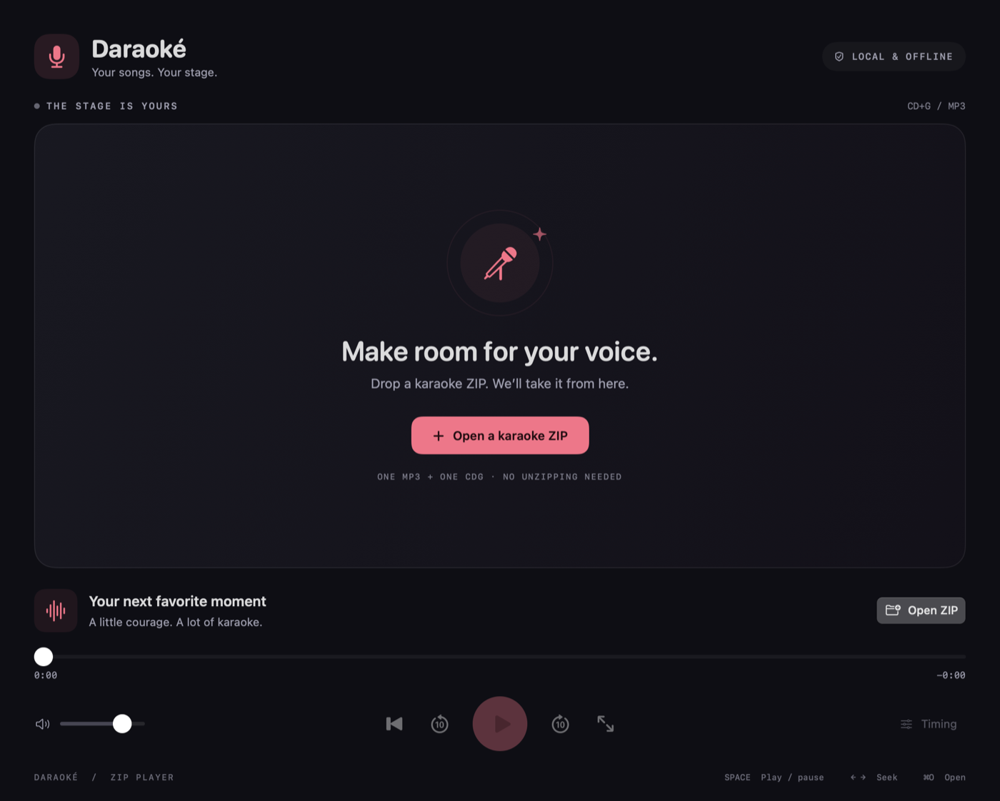

# Daraoké

**Your songs. Your stage.** A native, offline CD+G karaoke player for macOS, built with SwiftUI, AppKit, and AVFoundation.



## 0.1 — Drop & sing

Drop a ZIP onto the window, or use **Open ZIP** (`⌘O`). It should contain one MP3 and its CDG graphics; you do not need to unzip it. Playback starts automatically.

- Crisp CD+G graphics in a 4:3 stage, synchronized to the audio clock.
- Play/pause, seek, restart, skip, volume, and native fullscreen. Double-click the stage to enter or leave fullscreen.
- **Key adjustment:** whole semitones from −12 to +12 without changing tempo. −1 is half a tone down; −2 is one tone down. Use − / value / +, or click the value to reset to original key (0). Changes apply live; each newly opened song starts at 0.
- Lyrics timing adjustment from −3 to +3 seconds; positive values show lyrics earlier.
- Title, artist, and year from supported ID3 tags, with filename fallback.
- ZIP contents stay in memory: no extraction, upload, account, network service, or telemetry.
- An unavailable ZIP produces a recoverable error. A failed import does not replace the current song. A loaded song plays from memory even if its source drive disconnects.

**Requires macOS 14 or later.** Download the archive for Apple Silicon (`arm64`) or Intel (`x86_64`) from [Releases](https://github.com/orditeck/daraoke/releases), unzip the application, and move it to Applications. Builds are ad-hoc signed, not Developer ID signed or notarized. macOS may block the first launch; after checking the source, use **System Settings → Privacy & Security → Open Anyway**. Do not disable Gatekeeper globally.

The repository is private for now. Its owner decides when to make it public; there is no automatic publication or Pages deployment.

### Controls

| Action | Shortcut |
| --- | --- |
| Open karaoke ZIP | `⌘O` |
| Play / pause | `Space` |
| Seek backward / forward 5 seconds | `←` / `→` |
| Restart | `⌘R` |
| Fullscreen | Double-click the stage, or `⌃⌘F` (View menu) |
| Lower / raise key one semitone | `⌥⌘↓` / `⌥⌘↑` |
| Reset to original key | `⌥⌘0` |

A single matching pair inside nested folders is supported, including uppercase extensions and Finder metadata files. If there is only one MP3 and one CDG, different filenames are accepted. Ambiguous multi-song ZIPs are rejected rather than choosing a song silently.

### Current boundaries

0.1 is a single-song player, **not a library manager**. It does not yet scan directories, persist a catalog, open loose MP3/CDG pairs, manage a queue, change tempo, record microphones, or show a separate lyrics window.

The decoder implements basic CD+G instructions: palettes, normal/XOR tiles, memory/border presets, scrolling, and transparency. It does not correct subchannel parity errors or decode extended CD+G. Display metadata supports ID3v1 and common ID3v2.3/2.4 text frames; unsupported tag variants fall back to filenames. The graphics are bitmaps, not accessible lyric text.

Imports are bounded to a 512 MiB ZIP, 4,096 entries, a 128 MiB MP3, a 32 MiB CDG, and 512 MiB of decoded PCM audio. MP3 decoding runs in memory off the main actor. Stored/deflated, single-volume ZIPs are supported; encrypted, ZIP64, multipart, and symlink song entries are not.

## Development

Install Swift 6 or later using Xcode or Apple's Command Line Tools. No Rust, Node.js, CocoaPods, or third-party audio runtime is required.

```sh
swift run Daraoke
bash scripts/test.sh
bash scripts/package-macos.sh
```

The packaging command writes `build/Daraoké.app` and an architecture-specific distributable ZIP. To cross-build an Intel archive on Apple Silicon, use `ARCH=x86_64 bash scripts/package-macos.sh`. Run tests before packaging. `scripts/test.sh` also supports Command Line Tools installations where Swift Testing needs an explicit framework search path; with full Xcode, ordinary `swift test` works.

Open `Package.swift` in Xcode for native debugging. Tests use Swift Testing and generate their own archive/graphics fixtures in temporary directories; no karaoke media is checked in.

### Code layout

- `Sources/CDGCore`: Foundation-only CD+G decoder, independent of UI and audio. Single-thread confined, with reusable graphics buffers and deterministic backward seek/replay.
- `Sources/KaraokeImport`: bounded streaming ZIP import and display metadata parsing using [ZIPFoundation](https://github.com/weichsel/ZIPFoundation).
- `Sources/KaraokeAudio`: in-memory MP3 decoding, `AVAudioEngine`/`AVAudioPlayerNode` transport, and `AVAudioUnitTimePitch` with fixed rate 1. No-copy scheduling views share immutable PCM storage across seeks.
- `Sources/Daraoke`: SwiftUI player, AppKit graphics surface, and AVFoundation playback. Imports run off the main actor; UI and audio state live on the main actor.

Graphics timing follows the player's rendered source sample clock, accounting for reported DSP/output latency, not a separate wall-clock timer. Key changes alter pitch in cents without changing rate or rescheduling the track. The display timer requests frames only; palette/tile revisions avoid redrawing unchanged graphics. CD+G reference: Jim Bumgardner's [CD+G Revealed](https://jbum.com/cdg_revealed.html).

## Releases & project management

[GitHub milestones](https://github.com/orditeck/daraoke/milestones) and their issues are the source of truth for scope and acceptance criteria:

- **0.1 · Drop & sing** — native macOS single-ZIP playback, semitone key control, native menu fixes, and stage double-click fullscreen.
- **0.2 · Your library** — SQLite catalog, multiple source directories, incremental scans, metadata, search, and loose MP3/CDG pairs.
- **0.3 · Drives come and go** — offline sources, stable source identity, reconnect/relink, and safe scan reconciliation without deleting missing songs.
- **0.4 · Ready for a karaoke night** — queue, dual-screen lyrics, and signed/notarized distribution.
- **0.5 · Beyond macOS: feasibility** — Linux and Apple mobile investigations with explicit go/no-go decisions. SwiftUI/AppKit are not a Linux UI; a portable decoder does not imply a portable app. Android is exploratory, not committed.

### Contributing safely

Use issues to propose scope changes and pull requests for code. Include reproduction steps and verification, but **never upload karaoke ZIPs, MP3s, CDGs, personal library databases, local directory paths, or track-identifying screenshots**. Use original synthetic fixtures for regressions. Media patterns are ignored by Git, but do not force-add them. CI rejects tracked karaoke media.

The original software is [MIT licensed](LICENSE). That license does not grant rights to karaoke recordings, graphics, lyrics, or other media. Supply only media you are entitled to use.
